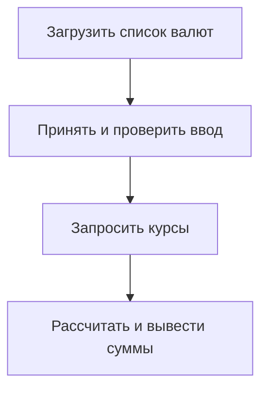

# Конвертер валют

[](https://github.com/yaleksandr89/freecurrencyapi-converter-python)
[](pyproject.toml)
[](https://github.com/yaleksandr89/freecurrencyapi-converter-python/actions/workflows/ci.yml)
[](LICENSE.md)


## Выберите язык

| Русский | English | Español | 中文 | Français | Deutsch |
| --- | --- | --- | --- | --- | --- |
| **Выбран** | [English](docs/langs/en/README.md) | [Español](docs/langs/es/README.md) | [中文](docs/langs/zh/README.md) | [Français](docs/langs/fr/README.md) | [Deutsch](docs/langs/de/README.md) |

Интерактивный конвертер на Python пересчитывает сумму из одной валюты в одну или несколько других по курсам FreecurrencyAPI. Ввод и результаты отображаются в терминале.

- Список доступных валют загружается при каждом интерактивном запуске.
- Курсы запрашиваются для выбранных валют после проверки ввода.
- Подсказки и сообщения доступны на русском и английском языках.

Для установки из исходников нужен Python 3.12 или новее. Для конвертации нужен собственный ключ FreecurrencyAPI. Команды ниже рассчитаны на Linux и macOS с `make`. В CI проверки выполняются на Ubuntu с Python 3.12, 3.13 и 3.14.

## Как проходит конвертация

Введите исходную валюту, сумму и целевые валюты. Конвертер получит курсы для выбранных кодов и покажет результат в терминале.



Порядок работы модулей, API-запросов и обработки сбоев подробно разобран в [описании архитектуры](docs/langs/ru/reference/architecture.md).

## Готовые сборки

Готовые сборки запускаются без установки Python. Когда архив для вашей системы появится на [странице релизов](https://github.com/yaleksandr89/freecurrencyapi-converter-python/releases), скачайте и распакуйте его. Скопируйте `.env.example` в `.env`, укажите свой `API_TOKEN` и запустите программу по инструкции во вложенном `README.md`.

## Быстрый старт из исходников

Склонируйте репозиторий, создайте виртуальное окружение с зависимостями и скопируйте шаблон настроек.

```bash
# Скачайте проект и перейдите в его каталог.
git clone https://github.com/yaleksandr89/freecurrencyapi-converter-python.git
cd freecurrencyapi-converter-python

# Создайте .venv и установите зависимости для разработки.
make setup

# Скопируйте шаблон настроек, не перезаписывая существующий .env.
cp -n .env.example .env
```

Запишите ключ из личного кабинета FreecurrencyAPI в `API_TOKEN` файла `.env`. Базовый адрес `API_URL` уже указан в шаблоне. Из корня проекта запустите конвертер одной из команд.

```bash
# Русский интерфейс.
make run

# Английский интерфейс.
make run CLI_LANG=en
```

Для Windows PowerShell порядок установки и запуска приведён в [руководстве по началу работы](docs/langs/ru/guides/getting-started.md). Параметры CLI, правила ввода и коды ошибок описаны в [справочнике команд](docs/langs/ru/reference/cli-and-errors.md).

## Демонстрация

### Успешная конвертация

Расчёт суммы и вывод результата.

https://github.com/user-attachments/assets/47d64727-342d-4cb8-ba4c-d223253b2338

### Ошибка при конвертации

Сообщение конвертера об ошибке.

https://github.com/user-attachments/assets/5b0408fb-e59c-467a-bef5-72b7e30c066b

### Переключение языка интерфейса

Запуск CLI с другим языком подсказок и сообщений.

https://github.com/user-attachments/assets/217d4e51-7e09-460e-a6be-c7712ecb7b0f

## Документация

- [Начало работы](docs/langs/ru/guides/getting-started.md)
- [Архитектура](docs/langs/ru/reference/architecture.md)
- [CLI и ошибки](docs/langs/ru/reference/cli-and-errors.md)
- [Участие в разработке](.github/CONTRIBUTING.md)

## Обратная связь

- Сообщить об ошибке или предложить улучшение — [GitHub Issues](https://github.com/yaleksandr89/freecurrencyapi-converter-python/issues).
- Обсудить использование конвертера — [GitHub Discussions](https://github.com/yaleksandr89/freecurrencyapi-converter-python/discussions).
- [Политика безопасности](.github/SECURITY.md).

<p align="center">
  Если проект оказался полезен, поставьте звезду на GitHub — так его будет проще найти другим. 🤘
</p>
