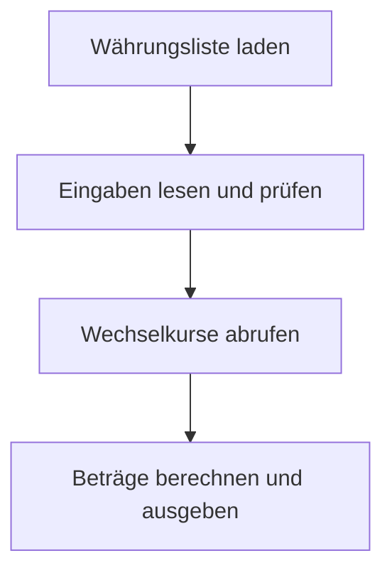

# Währungsrechner

[](https://github.com/yaleksandr89/freecurrencyapi-converter-python)
[](../../../pyproject.toml)
[](https://github.com/yaleksandr89/freecurrencyapi-converter-python/actions/workflows/ci.yml)
[](../../../LICENSE.md)


## Sprache wählen

| Русский | English | Español | 中文 | Français | Deutsch |
| --- | --- | --- | --- | --- | --- |
| [Русский](../../../README.md) | [English](../en/README.md) | [Español](../es/README.md) | [中文](../zh/README.md) | [Français](../fr/README.md) | **Ausgewählt** |

Ein interaktiver Python-Währungsrechner für die Kommandozeile. Er rechnet einen Betrag mithilfe der Wechselkurse von FreecurrencyAPI in eine oder mehrere Zielwährungen um.

- Die Liste der verfügbaren Währungen wird bei jedem interaktiven Start abgerufen.
- Die Kurse der ausgewählten Währungen werden erst nach der Eingabeprüfung angefordert.
- Eingabeaufforderungen und Meldungen sind auf Russisch und Englisch verfügbar.

Die Installation aus dem Quellcode erfordert Python 3.12 oder neuer. Für Umrechnungen ist ein eigener FreecurrencyAPI-Schlüssel erforderlich. Die folgenden Befehle gelten für Linux und macOS mit `make`. Die CI prüft Python 3.12, 3.13 und 3.14 unter Ubuntu.

## Ablauf einer Umrechnung

Geben Sie Ausgangswährung, Betrag und Zielwährungen ein. Der Rechner ruft die passenden Kurse ab und zeigt das Ergebnis im Terminal an.



Die [Architekturübersicht](reference/architecture.md) beschreibt Module, API-Aufrufe und Fehlerpfade.

## Eigenständige Programme

Die eigenständigen Programme laufen ohne Python-Installation. Sobald auf der [Releases-Seite](https://github.com/yaleksandr89/freecurrencyapi-converter-python/releases) ein Archiv für Ihr System verfügbar ist, laden Sie es herunter und entpacken Sie es. Kopieren Sie `.env.example` nach `.env`, tragen Sie Ihren Schlüssel in `API_TOKEN` ein und starten Sie das Programm gemäß der beiliegenden `README.md`.

## Schnellstart aus dem Quellcode

Klonen Sie das Repository, erstellen Sie die virtuelle Umgebung mit ihren Abhängigkeiten und kopieren Sie die Beispielkonfiguration.

```bash
# Repository klonen und in sein Verzeichnis wechseln.
git clone https://github.com/yaleksandr89/freecurrencyapi-converter-python.git
cd freecurrencyapi-converter-python

# .venv erstellen und Entwicklungsabhängigkeiten installieren.
make setup

# Beispielkonfiguration kopieren, ohne eine vorhandene .env zu überschreiben.
cp -n .env.example .env
```

Tragen Sie Ihren FreecurrencyAPI-Schlüssel unter `API_TOKEN` in `.env` ein. Die Basisadresse `API_URL` ist bereits vorbelegt. Führen Sie einen der folgenden Befehle im Projektverzeichnis aus.

```bash
# Russische Oberfläche.
make run

# Englische Oberfläche.
make run CLI_LANG=en
```

Die Installation und Ausführung mit Windows PowerShell beschreibt die [Einrichtungsanleitung](guides/getting-started.md). CLI-Optionen, Eingaberegeln und Exit-Codes stehen in der [CLI-Referenz](reference/cli-and-errors.md).

## Demonstrationen

### Erfolgreiche Umrechnung

Berechnung des Betrags und Ausgabe.

https://github.com/user-attachments/assets/47d64727-342d-4cb8-ba4c-d223253b2338

### Umrechnungsfehler

Fehlermeldung des Rechners.

https://github.com/user-attachments/assets/5b0408fb-e59c-467a-bef5-72b7e30c066b

### Sprache der Oberfläche wechseln

Start der CLI mit einer anderen Sprache für Eingaben und Meldungen.

https://github.com/user-attachments/assets/217d4e51-7e09-460e-a6be-c7712ecb7b0f

## Dokumentation

- [Erste Schritte](guides/getting-started.md)
- [Architektur](reference/architecture.md)
- [CLI und Fehler](reference/cli-and-errors.md)
- [Mitwirken](CONTRIBUTING.md)

## Rückmeldungen

- Fehler melden oder Verbesserung vorschlagen — [GitHub Issues](https://github.com/yaleksandr89/freecurrencyapi-converter-python/issues).
- Über die Verwendung des Rechners diskutieren — [GitHub Discussions](https://github.com/yaleksandr89/freecurrencyapi-converter-python/discussions).
- [Sicherheitsrichtlinie](SECURITY.md).

<p align="center">
  Wenn Ihnen dieses Projekt geholfen hat, geben Sie ihm einen Stern auf GitHub, damit andere es leichter finden. 🤘
</p>
