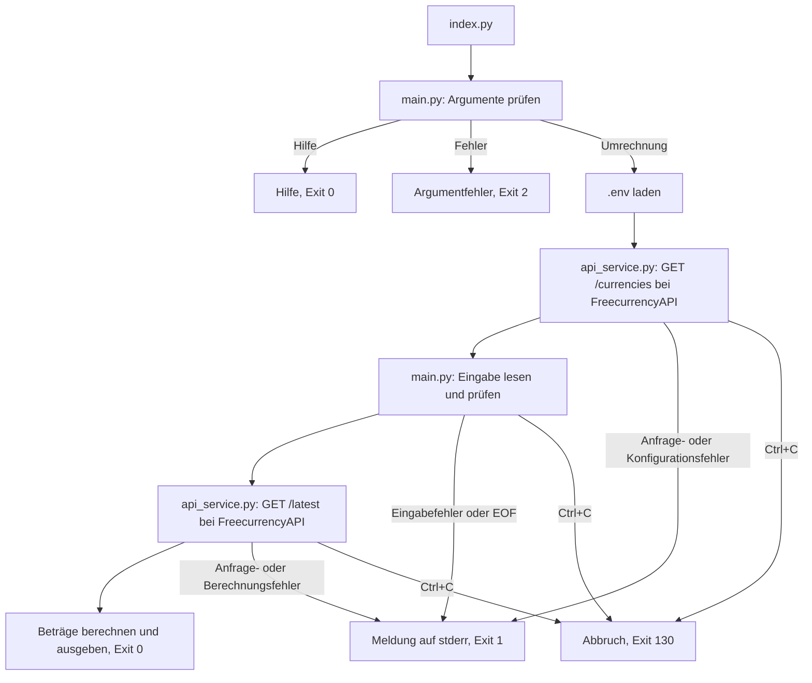

# Architektur des Währungsrechners

## Sprache wählen

| Русский | English | Español | 中文 | Français | Deutsch |
| --- | --- | --- | --- | --- | --- |
| [Русский](../../ru/reference/architecture.md) | [English](../../en/reference/architecture.md) | [Español](../../es/reference/architecture.md) | [中文](../../zh/reference/architecture.md) | [Français](../../fr/reference/architecture.md) | **Ausgewählt** |

## Komponenten

| Datei | Aufgabe |
| --- | --- |
| [`index.py`](../../../../index.py) | Ruft `main()` auf und gibt den Rückgabecode mittels `sys.exit()` an das Betriebssystem weiter. Im gepackten Windows-Programm ruft es vor dem Beenden `pause_after_explorer_launch()` auf. |
| [`windows_console.py`](../../../../src/currency_converter/windows_console.py) | Eine mit PyInstaller im Onefile-Modus erstellte Windows-EXE kann nach der Ausgabe auf die Eingabetaste warten, wenn sie direkt im Explorer geöffnet wird. Beim Start aus einem normalen Terminal beendet sich die CLI ohne diese Pause und gibt ihre üblichen Exitcodes zurück. |
| [`main.py`](../../../../src/currency_converter/main.py) | Verarbeitet Argumente, lädt `.env` beim interaktiven Start mit `load_dotenv()`, steuert den Dialog und gibt Ergebnisse oder Fehler aus. |
| [`i18n.py`](../../../../src/currency_converter/i18n.py) | Speichert russische und englische Texte für Hilfe, Eingabeaufforderungen und Fehlermeldungen. |
| [`api_service.py`](../../../../src/currency_converter/api_service.py) | Liest `API_TOKEN` und `API_URL` aus der Umgebung, sendet Anfragen über `requests`, prüft Antworten und berechnet umgerechnete Beträge. |

## Ablauf

Hilfe und Argumentfehler beenden das Programm, bevor `.env` geladen wird. Im interaktiven Modus ruft die CLI `/currencies` ab, prüft die Eingabe gegen diese Liste, fragt `/latest` an und zeigt das Ergebnis. Konfigurations-, Eingabe- und API-Fehler stoppen den jeweiligen Schritt.

`i18n.py` wird bei der Argumentverarbeitung und in der interaktiven Sitzung verwendet. Ctrl+C wird auch während laufender Anfragen behandelt. Währungslisten, Kurse und Ergebnisse befinden sich nur im Prozessspeicher. Der Rechner legt keine Historie an und speichert keine Ergebnisse auf der Festplatte.

## Tests und Prüfungen

Die [Tests](../../../../tests/test_converter.py) simulieren API-Antworten und Netzwerkfehler und prüfen Anfrageparameter, Berechnungen, Ausgabe sowie Exit-Codes. Die CI führt sie unter Ubuntu mit `make check` zusammen mit Stil-, Formatierungs- und Abhängigkeitsprüfungen aus.
