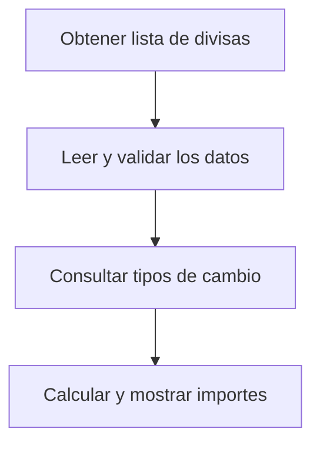

# Convertidor de divisas

[](https://github.com/yaleksandr89/freecurrencyapi-converter-python)
[](../../../pyproject.toml)
[](https://github.com/yaleksandr89/freecurrencyapi-converter-python/actions/workflows/ci.yml)
[](../../../LICENSE.md)


## Elegir idioma

| Русский | English | Español | 中文 | Français | Deutsch |
| --- | --- | --- | --- | --- | --- |
| [Русский](../../../README.md) | [English](../en/README.md) | **Seleccionado** | [中文](../zh/README.md) | [Français](../fr/README.md) | [Deutsch](../de/README.md) |

Conversor interactivo para la terminal, escrito en Python. Convierte una cantidad de una divisa a una o varias más utilizando los tipos de cambio de FreecurrencyAPI.

- La lista de divisas disponibles se obtiene al inicio de cada ejecución interactiva.
- Los tipos de cambio de las divisas seleccionadas se solicitan después de validar los datos introducidos.
- Los mensajes y las indicaciones del programa están disponibles en ruso e inglés.

La instalación desde el código fuente requiere Python 3.12 o posterior. Para convertir divisas se necesita una clave propia de FreecurrencyAPI. Los comandos siguientes se ejecutan en Linux y macOS con `make`. El CI comprueba Python 3.12, 3.13 y 3.14 en Ubuntu.

## Cómo funciona la conversión

Indique la divisa de origen, el importe y las divisas de destino. El conversor consulta los tipos de cambio y muestra el resultado en la terminal.



El [documento de arquitectura](reference/architecture.md) explica los módulos, las solicitudes a la API y la gestión de errores.

## Versiones ejecutables

Las versiones ejecutables funcionan sin instalar Python. Cuando haya un archivo para su sistema en la [página de lanzamientos](https://github.com/yaleksandr89/freecurrencyapi-converter-python/releases), descárguelo y descomprímalo. Copie `.env.example` a `.env`, configure `API_TOKEN` con su clave y siga las instrucciones del `README.md` incluido para iniciar el programa.

## Inicio rápido desde el código fuente

Clone el repositorio, cree el entorno virtual con sus dependencias y copie el ejemplo de configuración.

```bash
# Clonar el repositorio y entrar en su directorio.
git clone https://github.com/yaleksandr89/freecurrencyapi-converter-python.git
cd freecurrencyapi-converter-python

# Crear .venv e instalar las dependencias de desarrollo.
make setup

# Copiar la configuración sin sobrescribir un .env existente.
cp -n .env.example .env
```

Introduzca la clave de su cuenta de FreecurrencyAPI en `API_TOKEN` del archivo `.env`. El ejemplo ya contiene la dirección base `API_URL`. Ejecute uno de estos comandos desde la raíz del proyecto.

```bash
# Interfaz en ruso.
make run

# Interfaz en inglés.
make run CLI_LANG=en
```

Para instalar y ejecutar en Windows PowerShell, consulte la [guía de inicio](guides/getting-started.md). Las opciones, reglas de entrada y códigos de salida se describen en la [referencia de CLI](reference/cli-and-errors.md).

## Demostraciones

### Conversión correcta

Cálculo del importe y presentación del resultado.

https://github.com/user-attachments/assets/47d64727-342d-4cb8-ba4c-d223253b2338

### Error de conversión

Mensaje de error del conversor.

https://github.com/user-attachments/assets/5b0408fb-e59c-467a-bef5-72b7e30c066b

### Cambio de idioma de la interfaz

Inicio del CLI con otro idioma para mensajes e indicaciones.

https://github.com/user-attachments/assets/217d4e51-7e09-460e-a6be-c7712ecb7b0f

## Documentación

- [Guía de inicio](guides/getting-started.md)
- [Arquitectura](reference/architecture.md)
- [CLI y errores](reference/cli-and-errors.md)
- [Contribuir](CONTRIBUTING.md)

## Comentarios y sugerencias

- Notificar un error o proponer una mejora — [GitHub Issues](https://github.com/yaleksandr89/freecurrencyapi-converter-python/issues).
- Hablar sobre el uso del conversor — [GitHub Discussions](https://github.com/yaleksandr89/freecurrencyapi-converter-python/discussions).
- [Política de seguridad](SECURITY.md).

<p align="center">
  Si este proyecto le ha resultado útil, dele una estrella en GitHub para que otros puedan encontrarlo. 🤘
</p>
