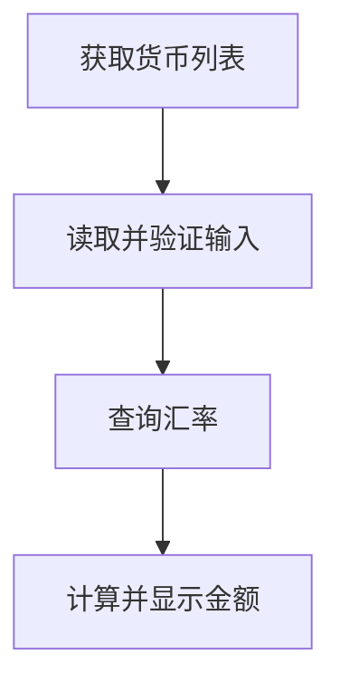

# 货币转换器

[](https://github.com/yaleksandr89/freecurrencyapi-converter-python)
[](../../../pyproject.toml)
[](https://github.com/yaleksandr89/freecurrencyapi-converter-python/actions/workflows/ci.yml)
[](../../../LICENSE.md)


## 选择语言

| Русский | English | Español | 中文 | Français | Deutsch |
| --- | --- | --- | --- | --- | --- |
| [Русский](../../../README.md) | [English](../en/README.md) | [Español](../es/README.md) | **当前语言** | [Français](../fr/README.md) | [Deutsch](../de/README.md) |

使用 Python 编写的交互式命令行货币转换器。它通过 FreecurrencyAPI 提供的汇率，将一种货币的金额换算成一种或多种目标货币，并在终端显示结果。

- 每次交互式启动时都会获取可用货币列表。
- 验证输入后，才会请求所选货币的汇率。
- 命令行提示和消息目前支持俄语与英语。

从源代码安装需要 Python 3.12 或更高版本。进行货币转换需要您自己的 FreecurrencyAPI 密钥。以下命令适用于使用 `make` 的 Linux 和 macOS。CI 在 Ubuntu 上检查 Python 3.12、3.13 和 3.14。

## 转换流程

输入源货币、金额和目标货币。程序获取对应汇率，并在终端显示计算结果。



模块职责、API 请求及错误处理流程详见[架构说明](reference/architecture.md)。

## 独立可执行版本

独立可执行版本无需安装 Python。您的系统对应的压缩包在[发布页面](https://github.com/yaleksandr89/freecurrencyapi-converter-python/releases)提供后，下载并解压。将 `.env.example` 复制为 `.env`，把您自己的密钥填入 `API_TOKEN`，然后按压缩包内的 `README.md` 运行程序。

## 从源代码快速开始

克隆仓库，创建安装依赖的虚拟环境，并复制配置模板。

```bash
# 克隆仓库并进入项目目录。
git clone https://github.com/yaleksandr89/freecurrencyapi-converter-python.git
cd freecurrencyapi-converter-python

# 创建 .venv 并安装开发依赖。
make setup

# 复制配置模板，不覆盖已有的 .env。
cp -n .env.example .env
```

打开 `.env`，将 `API_TOKEN` 替换为 FreecurrencyAPI 账户中的密钥。模板已提供 `API_URL` 基础地址。在仓库根目录执行以下命令之一。

```bash
# 俄语界面。
make run

# 英语界面。
make run CLI_LANG=en
```

Windows PowerShell 的安装与启动步骤参见[入门指南](guides/getting-started.md)。CLI 参数、输入规则和退出码见 [CLI 参考文档](reference/cli-and-errors.md)。

## 演示

### 成功转换

计算金额并显示结果。

https://github.com/user-attachments/assets/47d64727-342d-4cb8-ba4c-d223253b2338

### 转换错误

转换器输出的错误信息。

https://github.com/user-attachments/assets/5b0408fb-e59c-467a-bef5-72b7e30c066b

### 切换界面语言

通过启动参数切换命令行提示和消息语言。

https://github.com/user-attachments/assets/217d4e51-7e09-460e-a6be-c7712ecb7b0f

## 文档

- [入门指南](guides/getting-started.md)
- [架构](reference/architecture.md)
- [CLI 与错误](reference/cli-and-errors.md)
- [参与开发](CONTRIBUTING.md)

## 反馈

- 报告错误或提出改进建议 — [GitHub Issues](https://github.com/yaleksandr89/freecurrencyapi-converter-python/issues).
- 讨论转换器的使用 — [GitHub Discussions](https://github.com/yaleksandr89/freecurrencyapi-converter-python/discussions).
- [安全政策](SECURITY.md).

<p align="center">
  如果这个项目对您有帮助，欢迎在 GitHub 上点个 Star，让更多人发现它。🤘
</p>
