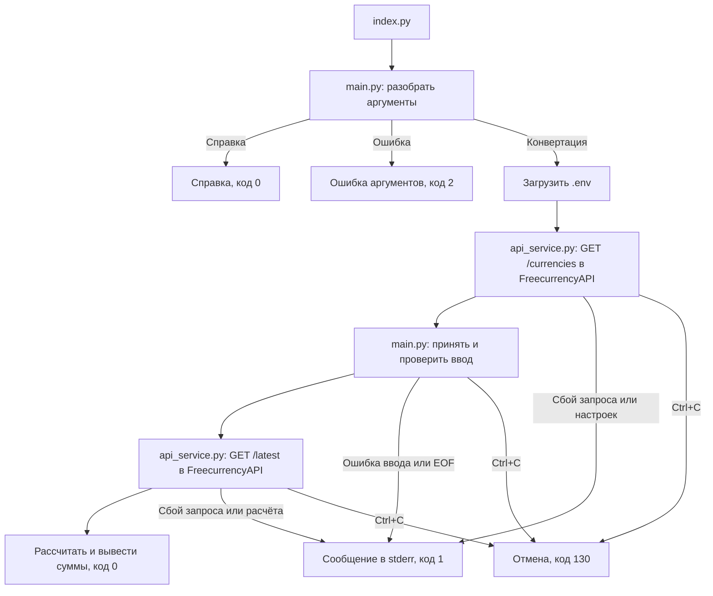

# Архитектура конвертера

## Компоненты

| Файл | Ответственность |
| --- | --- |
| [`index.py`](../../index.py) | Вызывает `main()` и передаёт возвращённый код операционной системе через `sys.exit()`. |
| [`main.py`](../../src/currency_converter/main.py) | Разбирает аргументы, загружает `.env` через `load_dotenv()` при интерактивном запуске, ведёт диалог и выводит результаты или ошибки. |
| [`i18n.py`](../../src/currency_converter/i18n.py) | Хранит русские и английские тексты справки, подсказок и ошибок. |
| [`api_service.py`](../../src/currency_converter/api_service.py) | Читает `API_TOKEN` и `API_URL` из окружения, отправляет запросы через `requests`, проверяет ответы и пересчитывает сумму. |

## Порядок выполнения

Справка и ошибки разбора аргументов завершают работу до чтения `.env`. В интерактивном режиме CLI загружает список валют из `/currencies`, проверяет ввод по этому списку, получает курсы из `/latest` и выводит расчёт. При ошибке конфигурации, ввода или API программа останавливается на соответствующем этапе.

`i18n.py` используется при разборе аргументов и в интерактивном сеансе. Прерывание Ctrl+C обрабатывается в течение сеанса, в том числе при сетевом запросе. Список валют, курсы и результаты хранятся в памяти текущего процесса. Конвертер не ведёт историю и не записывает результаты на диск.

## Проверки

[Тесты](../../tests/test_converter.py) подставляют ответы API и ошибки сети, проверяют параметры запросов, расчёты, вывод и коды завершения. CI запускает эти тесты на Ubuntu через `make check` вместе с проверками стиля, форматирования и зависимостей.
