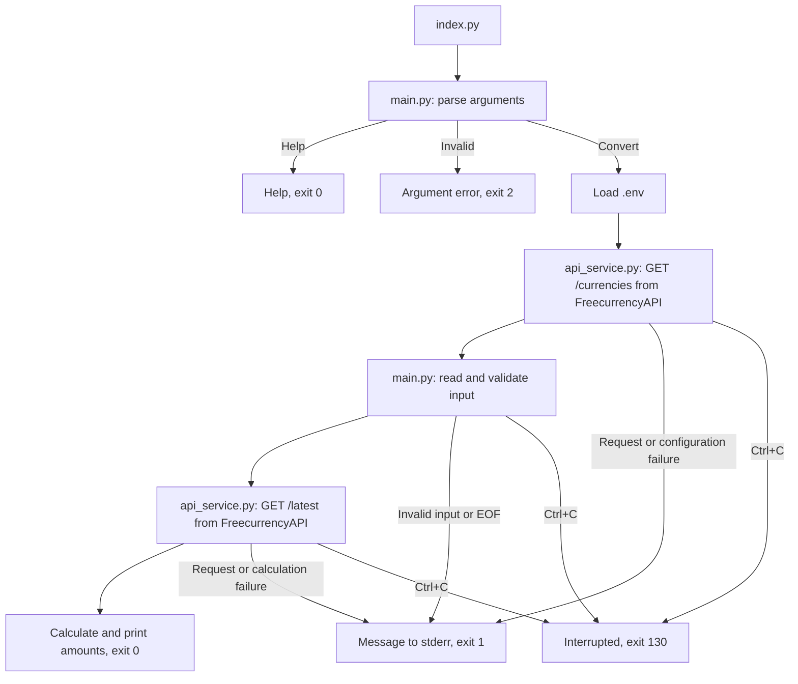

# Converter architecture

## Choose language

| Русский | English | Español | 中文 | Français | Deutsch |
| --- | --- | --- | --- | --- | --- |
| [Русский](architecture.md) | **Selected** | [Español](architecture_es.md) | [中文](architecture_zh.md) | [Français](architecture_fr.md) | [Deutsch](architecture_de.md) |

## Components

| File | Responsibility |
| --- | --- |
| [`index.py`](../../index.py) | Calls `main()` and passes its return code to the operating system through `sys.exit()`. On frozen Windows builds it calls `pause_after_explorer_launch()` before exiting. |
| [`windows_console.py`](../../src/currency_converter/windows_console.py) | A Windows PyInstaller onefile EXE launched directly from Explorer may wait for Enter after printing its output. When launched from a regular terminal, the CLI exits without this pause and returns its usual exit codes. |
| [`main.py`](../../src/currency_converter/main.py) | Parses arguments, loads `.env` via `load_dotenv()` for interactive runs, handles prompts, and prints results or errors. |
| [`i18n.py`](../../src/currency_converter/i18n.py) | Stores Russian and English help text, prompts, and error messages. |
| [`api_service.py`](../../src/currency_converter/api_service.py) | Reads `API_TOKEN` and `API_URL` from the environment, sends requests through `requests`, validates responses, and computes converted amounts. |

## Execution flow

Help and argument errors terminate before `.env` is loaded. During an interactive run the CLI requests `/currencies`, validates input against that list, requests `/latest`, and prints the result. Configuration, input, and API failures stop the program at the relevant step.

`i18n.py` is used both when parsing options and during interactive conversion. Ctrl+C is handled during the session, including while a request is in progress. Currency lists, rates, and results remain in process memory. The converter does not store history or write results to disk.

## Tests and checks

The [tests](../../tests/test_converter.py) replace API responses and network failures, validating query parameters, calculations, output, and exit codes. CI runs them on Ubuntu through `make check`, together with linting, formatting, and dependency checks.
