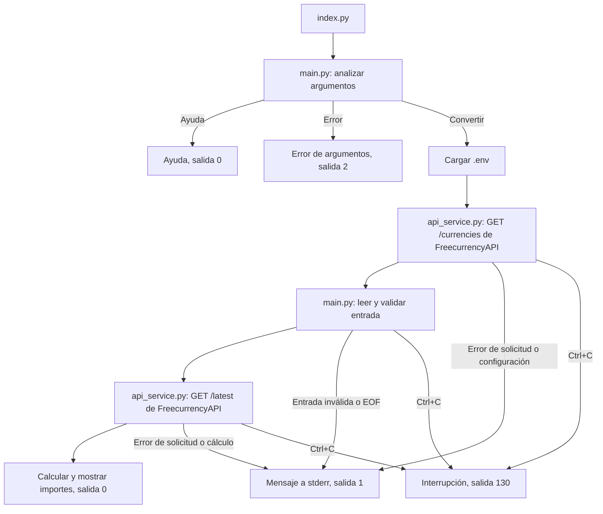

# Arquitectura del conversor

## Elegir idioma

| Русский | English | Español | 中文 | Français | Deutsch |
| --- | --- | --- | --- | --- | --- |
| [Русский](architecture.md) | [English](architecture_en.md) | **Seleccionado** | [中文](architecture_zh.md) | [Français](architecture_fr.md) | [Deutsch](architecture_de.md) |

## Componentes

| Archivo | Responsabilidad |
| --- | --- |
| [`index.py`](../../index.py) | Invoca `main()` y entrega su código de salida al sistema operativo mediante `sys.exit()`. |
| [`main.py`](../../src/currency_converter/main.py) | Analiza los argumentos, carga `.env` con `load_dotenv()` para la ejecución interactiva, gestiona el diálogo y muestra resultados o errores. |
| [`i18n.py`](../../src/currency_converter/i18n.py) | Guarda los textos de ayuda, indicaciones y errores en ruso e inglés. |
| [`api_service.py`](../../src/currency_converter/api_service.py) | Lee `API_TOKEN` y `API_URL` del entorno, realiza solicitudes con `requests`, valida las respuestas y calcula los importes convertidos. |

## Secuencia de ejecución

La ayuda y los errores de argumentos terminan antes de cargar `.env`. En modo interactivo, el CLI obtiene `/currencies`, valida los datos con la lista, solicita `/latest` y muestra el cálculo. Los errores de configuración, entrada o API detienen el programa en la fase correspondiente.

`i18n.py` interviene al analizar argumentos y durante la sesión interactiva. Ctrl+C se gestiona también mientras se realiza una solicitud. La lista de divisas, los tipos de cambio y los resultados permanecen en memoria. No se guarda un historial ni se escriben resultados en disco.

## Pruebas y comprobaciones

Las [pruebas](../../tests/test_converter.py) simulan respuestas y fallos de red, y verifican parámetros de solicitud, cálculos, salida y códigos de terminación. CI las ejecuta en Ubuntu mediante `make check`, junto con las comprobaciones de estilo, formato y dependencias.
