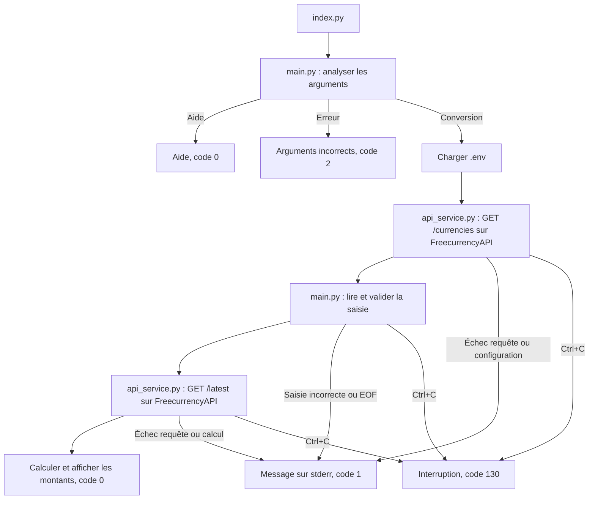

# Architecture du convertisseur

## Choisir la langue

| Русский | English | Español | 中文 | Français | Deutsch |
| --- | --- | --- | --- | --- | --- |
| [Русский](architecture.md) | [English](architecture_en.md) | [Español](architecture_es.md) | [中文](architecture_zh.md) | **Sélectionné** | [Deutsch](architecture_de.md) |

## Composants

| Fichier | Responsabilité |
| --- | --- |
| [`index.py`](../../index.py) | Appelle `main()` et transmet son code de retour au système d’exploitation via `sys.exit()`. Dans la version empaquetée pour Windows, il appelle `pause_after_explorer_launch()` avant de quitter. |
| [`windows_console.py`](../../src/currency_converter/windows_console.py) | Un EXE Windows créé en mode onefile de PyInstaller et lancé directement depuis l’Explorateur peut attendre la touche Entrée après l’affichage. Depuis un terminal ordinaire, le CLI se termine sans cette pause et renvoie ses codes de sortie habituels. |
| [`main.py`](../../src/currency_converter/main.py) | Analyse les arguments, charge `.env` avec `load_dotenv()` en mode interactif, gère les invites et affiche résultats ou erreurs. |
| [`i18n.py`](../../src/currency_converter/i18n.py) | Contient les textes russes et anglais de l’aide, des invites et des erreurs. |
| [`api_service.py`](../../src/currency_converter/api_service.py) | Lit `API_TOKEN` et `API_URL` dans l’environnement, envoie des requêtes avec `requests`, valide les réponses et calcule les montants convertis. |

## Déroulement de l’exécution

L’affichage de l’aide et les erreurs d’arguments terminent avant le chargement de `.env`. En mode interactif, le CLI interroge `/currencies`, valide la saisie, demande `/latest`, puis affiche le calcul. Une erreur de configuration, de saisie ou d’API arrête le traitement à l’étape correspondante.

`i18n.py` intervient lors de l’analyse des arguments et pendant la session interactive. Ctrl+C est pris en charge durant la session, y compris pendant une requête. Les devises, taux et résultats restent en mémoire du processus. Le convertisseur ne conserve aucun historique et n’écrit pas les résultats sur disque.

## Tests et contrôles

Les [tests](../../tests/test_converter.py) simulent réponses API et erreurs réseau, et vérifient paramètres des requêtes, calculs, affichage et codes de sortie. La CI les exécute sur Ubuntu avec `make check`, ainsi que les contrôles de style, de formatage et de dépendances.
