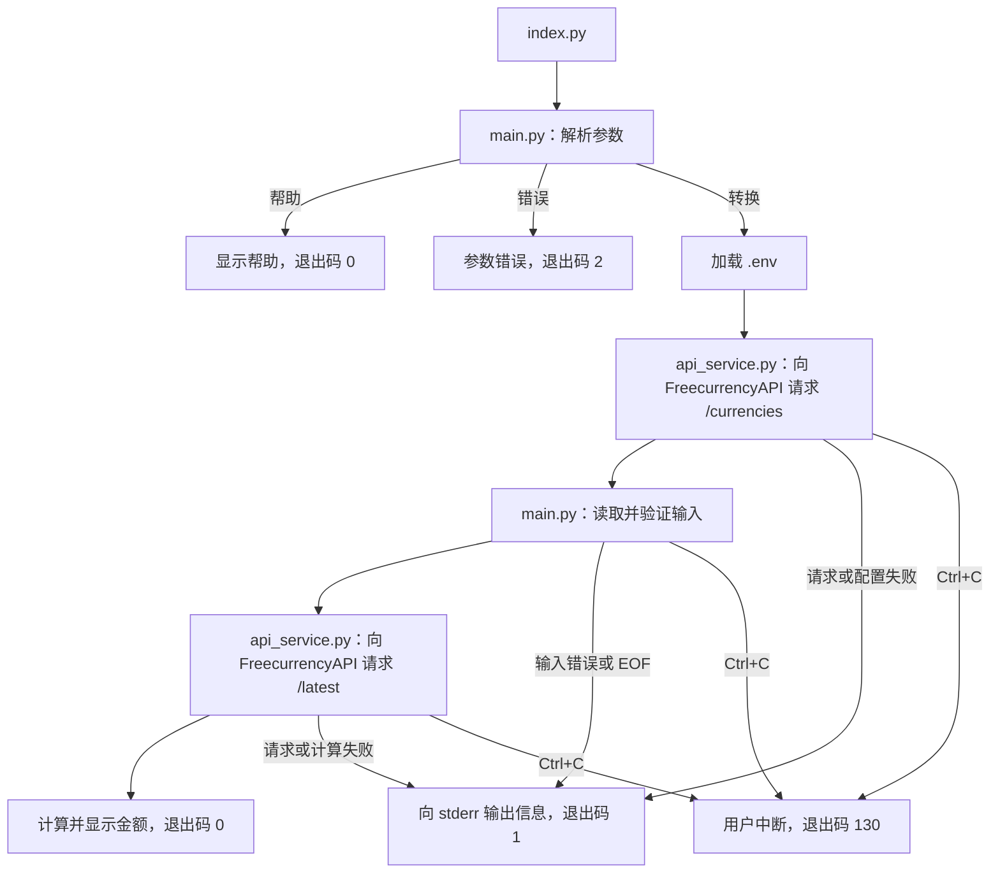

# 转换器架构

## 选择语言

| Русский | English | Español | 中文 | Français | Deutsch |
| --- | --- | --- | --- | --- | --- |
| [Русский](architecture.md) | [English](architecture_en.md) | [Español](architecture_es.md) | **当前语言** | [Français](architecture_fr.md) | [Deutsch](architecture_de.md) |

## 组件

| 文件 | 职责 |
| --- | --- |
| [`index.py`](../../index.py) | 调用 `main()` 并通过 `sys.exit()` 将返回码交给操作系统。 |
| [`main.py`](../../src/currency_converter/main.py) | 解析命令行参数；交互式启动时通过 `load_dotenv()` 加载 `.env`；处理输入、结果与错误信息。 |
| [`i18n.py`](../../src/currency_converter/i18n.py) | 保存俄语和英语的帮助、提示及错误文本。 |
| [`api_service.py`](../../src/currency_converter/api_service.py) | 从环境读取 `API_TOKEN` 和 `API_URL`，通过 `requests` 发送请求、验证响应并计算换算金额。 |

## 执行流程

显示帮助或发现参数错误时，会在读取 `.env` 前退出。交互式运行先请求 `/currencies`，根据货币列表校验输入，再请求 `/latest` 并显示计算结果。配置、输入或 API 错误会在对应步骤终止运行。

`i18n.py` 用于参数解析和交互式会话。程序也会在网络请求期间处理 Ctrl+C 中断。货币列表、汇率和结果只保存在当前进程内存中，不记录历史，也不将结果写入磁盘。

## 测试与检查

[测试](../../tests/test_converter.py)通过模拟 API 响应及网络故障，检查请求参数、计算结果、输出和退出码。CI 在 Ubuntu 上通过 `make check` 运行测试，并检查代码风格、格式和依赖。
